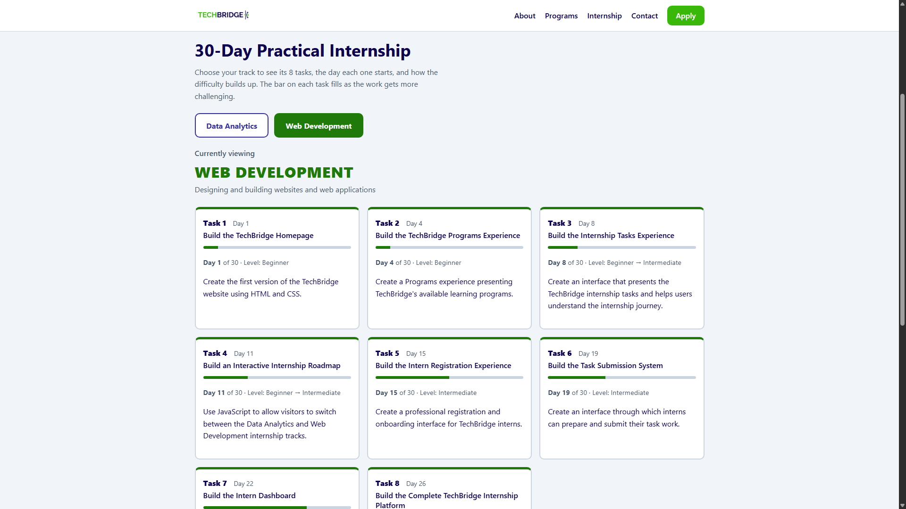
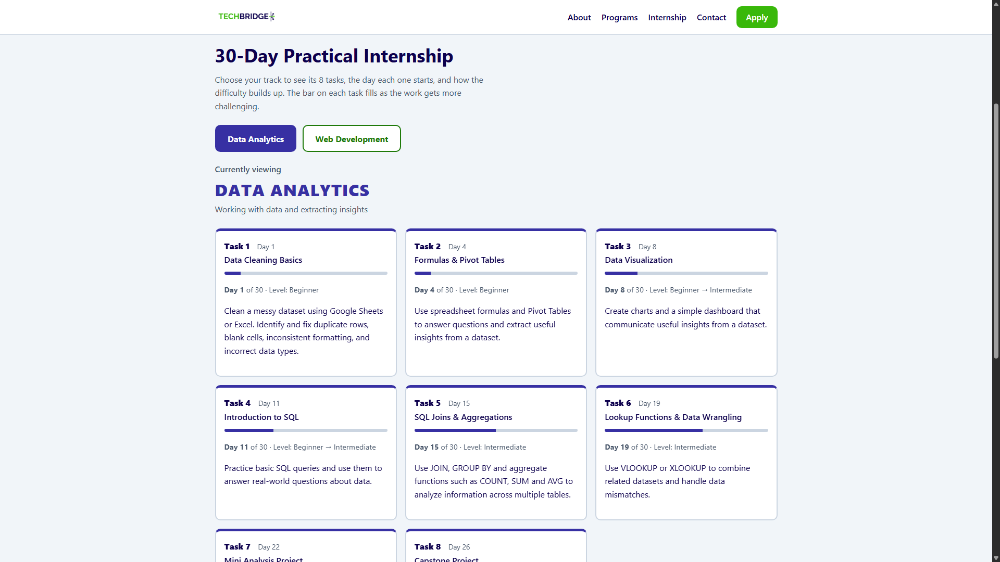
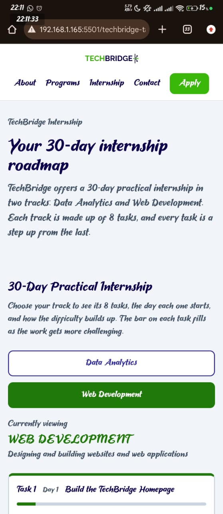

# TechBridge Task 4

Live site: https://new-git-stack.github.io/techbridge-task-4/

## Developer note
I structured the roadmap as one page with a pair of buttons at the top for choosing between the Data Analytics and Web Development tracks, plus a “Currently viewing” label that shows which track is active. All the task information is stored in a single JavaScript object called tracks, where each track holds an array of task objects containing the task number, title, day, description, difficulty label, and a numeric level. When a visitor clicks a track button, an event listener calls a showTrack function that checks the track exists, updates the current track variable, and rebuilds the eight task cards in the DOM without refreshing the page. In this task I used variables, arrays, objects, functions, event listeners, conditional logic, and DOM manipulation. My main challenge was showing the difficulty progression clearly, because the official labels only have three categories, which made it hard to tell tasks within the same category apart. I solved this by giving every task object its own numeric level that controls how full its difficulty bar is, while keeping the official label as text on the card. I also made every task’s details always visible so each one shows its number, title, day, description, and difficulty without any clicking.
